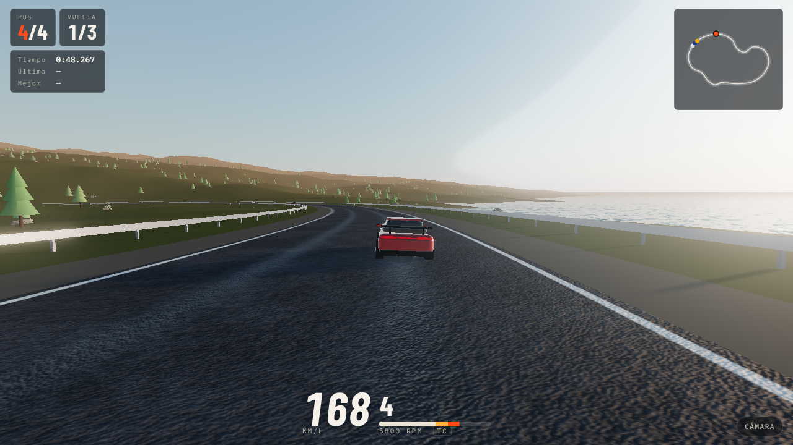

# Cornisa

Juego de carreras en 3D para navegador: un circuito original de 2,4 km por la costa al atardecer,
3 vueltas contra 3 rivales con IA. Sales último.

**Jugar:** abre `index.html` en un navegador de escritorio o móvil con conexión a internet (three.js
r170 se carga desde jsDelivr). Mejor con teclado o mando.

| Acción | Teclado | Mando | Táctil |
|---|---|---|---|
| Acelerar / frenar | W S · ↑ ↓ | RT / LT | GAS / FRENO |
| Girar | A D · ← → | stick izquierdo | ◀ ▶ |
| Freno de mano | Espacio | A | — |
| Cámara · volver a la pista · control de tracción | C · R · T | — | botón CÁMARA |
| Sonido · pausa | M · P | — | — |

## Qué lo hace realista

- **Física del vehículo (modelo de bicicleta a 120 Hz):** ángulos de deriva por eje, círculo de
  adherencia trasero compartido entre tracción y giro, transferencia de pesos al acelerar y frenar,
  neumáticos traseros más anchos, aerodinámica y resistencia a la rodadura, hierba con menos agarre.
- **Motor y caja:** curva de par (460 Nm a 5.200 rpm), corte a 7.800 rpm, 6 marchas automáticas,
  embrague que patina al salir, marcha atrás. 0-100 km/h en ~4,8 s medido en el propio juego.
- **Control de tracción** desactivable (T). Sin él, a fondo en marchas cortas la trasera se suelta.
- **IA:** perfil de velocidad calculado desde la curvatura del trazado (límite de adherencia + frenada
  a 8,5 m/s² hacia atrás), trazada interior en curvas, adelantamientos y algo de "goma elástica".
- **Imagen:** cielo físico (Rayleigh/Mie) que también genera los reflejos, pintura con barniz
  (clearcoat), asfalto con mapas de rugosidad y relieve, sombras, mar con reflejos animados, niebla,
  bloom y tone mapping ACES. Marcas de frenada en el asfalto.
- **Sonido sintetizado** con Web Audio: armónicos de un 6 cilindros según las rpm y la carga, admisión,
  chirrido de neumáticos según el deslizamiento, viento, grava, golpes, cambios de marcha y los motores
  de los rivales con panorámica estéreo.

Todo es procedural: no hay modelos, texturas ni sonidos descargados.

`cornisa.html` es la misma página sin el esqueleto `<html>`, publicada como Artifact de claude.ai.
