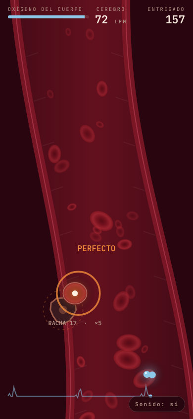

# Latido

Juego de ritmo original para navegador. Eres un átomo de hierro (Fe-56) dentro de un glóbulo rojo.
La sangre avanza a golpes con cada latido. Toca en el compás para impulsarte, recoge oxígeno en el
pulmón y llévalo a las células hambrientas de cada órgano esquivando coágulos. En cada vuelta al
cuerpo el corazón se acelera (72 → 150 lpm).

**Jugar:** abre `index.html` en cualquier navegador. No necesita servidor, dependencias ni assets.

| Acción | Táctil | Teclado |
|---|---|---|
| Impulso en el latido | Toca la pantalla | Espacio / ↑ / W |
| Moverse | Arrastra el dedo | ← → / A D |
| Silenciar | Botón *Sonido* | M |

## Cómo está hecho

- Un solo archivo HTML: canvas 2D y JavaScript sin librerías.
- **Todo el audio se sintetiza en tiempo real con Web Audio**: latido de dos golpes, bajo y acordes en
  re menor (Dm–Bb–F–C), y capas de música que se suman con tu racha (arpegio a 4, shaker a 10,
  contramelodía a 20). Los aciertos suenan en una escala pentatónica que sube con la racha, y al
  morir suena la línea plana del monitor.
- El ritmo se programa con el reloj de audio (`AudioContext.currentTime`) y un planificador con
  anticipación, así que los golpes y la ventana de acierto (±85 ms perfecto, ±160 ms bien) no
  dependen de los fotogramas.
- Un anillo que se cierra sobre el jugador y un electrocardiograma en la parte inferior marcan cuándo
  llega el siguiente latido.
- Récord guardado en `localStorage` (si el navegador lo permite).

`latido.html` es la misma página sin el esqueleto `<html>`, publicada como Artifact de claude.ai.
